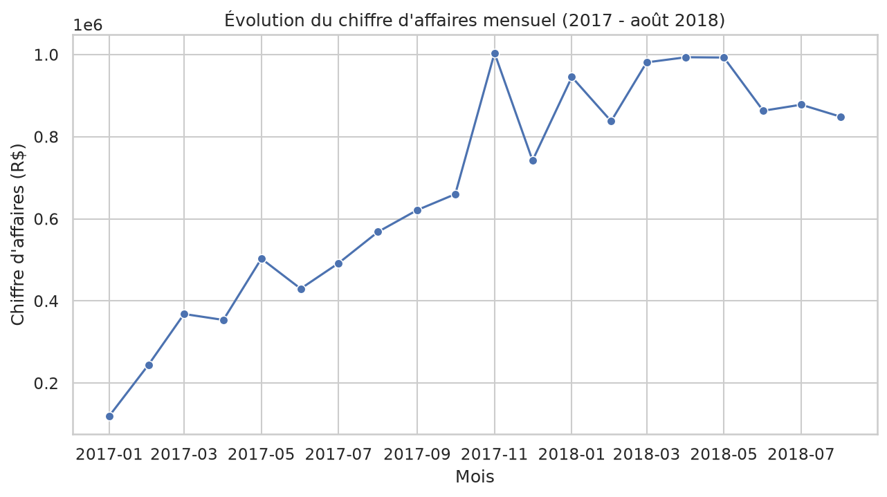
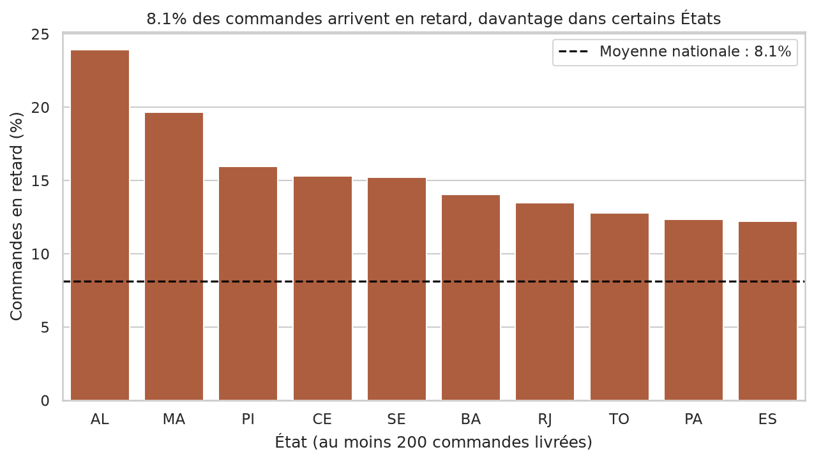
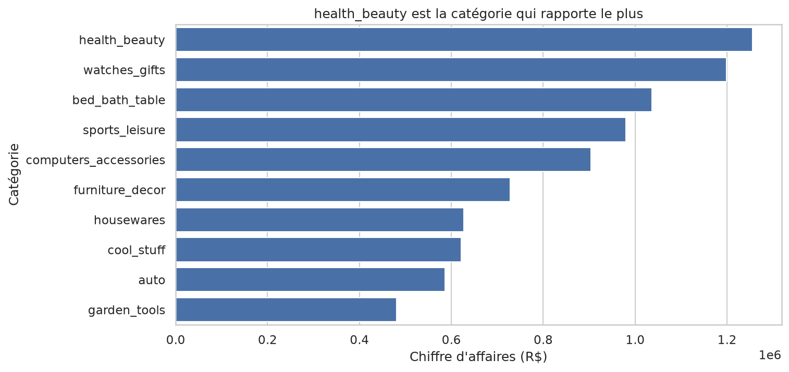

# Analyse des ventes Olist (e-commerce brésilien, 2016-2018)

## Questions étudiées
1. Quelles catégories de produits rapportent le plus de chiffre d'affaires ?
2. Comment le chiffre d'affaires évolue-t-il mois par mois ?
3. Quels États brésiliens concentrent le plus de commandes ?
4. Quelle part des commandes est livrée en retard, et où ?
5. Le prix d'un produit est-il lié à ses frais de port ?

## Source
Brazilian E-Commerce Public Dataset by Olist, Kaggle
https://www.kaggle.com/datasets/olistbr/brazilian-ecommerce
Licence CC BY-NC-SA 4.0, téléchargé le 23/10/2026.

## Installation
```bash
python3 -m venv .venv
source .venv/bin/activate
pip install -r requirements.txt
```

## Données
Les données brutes ne sont pas dans Git (data/raw/ est ignoré).
1. Télécharger le jeu sur le lien ci-dessus (Download, puis dataset as zip)
2. Décompresser dans data/raw/ : `unzip archive.zip -d data/raw`

## Ordre d'exécution
1. notebooks/01_exploration.ipynb
2. notebooks/02_nettoyage.ipynb (produit data/processed/)
3. notebooks/03_analyse.ipynb (produit figures/)

## Principaux résultats






## Limites
Données de 2016 à 2018 seulement, pas de coût d'achat donc pas de marge, commandes annulées exclues des questions 1 et 2, chiffre d'affaires = prix hors frais de port.
